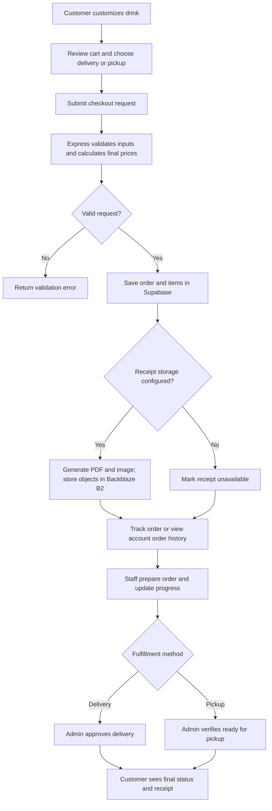

# Coffee Lab — Project Documentation

## 1. Project Overview

Coffee Lab is a responsive coffee customizer and ordering web application. Customers configure drinks, see estimated composition and nutrition, place delivery or pickup orders, and review order progress. Staff and administrators have separate order-management capabilities. The application uses a plain HTML/CSS/JavaScript frontend, a Node.js/Express API deployed on Render, Supabase for the PostgreSQL database and authentication, Backblaze B2 as the receipt object-storage container, and GitHub for source control.

This document describes the repository as inspected on October 26, 2026, with branch, setup, and AI-logging details updated on October 30, 2026. Quick-start setup lives in `README.md`. It distinguishes checked-in implementation from recommended deployment practices and from production behavior that cannot be verified from source code alone.

## 2. Project Architecture & Plan

### High-level architecture

```text
Browser
  index.html + public/css + public/js
       │ same-origin JSON/HTTP requests
       ▼
Express application (server.js)
  routes → request validation/auth middleware → controllers → services
       │ service-role operations; credentials remain server-side
       ├── Supabase Postgres and Supabase Auth
       └── Backblaze B2 object storage for generated receipt PDFs and images
```

Source code is maintained in GitHub (`SAKMAL08-maker/coffee-website`). The Express application is deployed to Render. Render hosts the application; Supabase and Backblaze remain external managed services.

| Layer                        | Location                                                                                         | Responsibility                                                                                                                                      |
| ---------------------------- | ------------------------------------------------------------------------------------------------ | --------------------------------------------------------------------------------------------------------------------------------------------------- |
| User interface               | `index.html`, `public/privacy.html`, `public/css/styles.css`                                     | Semantic page structure, privacy policy page, responsive styling, controls, dialogs, and customer/admin views.                                      |
| Browser state and behavior   | `public/js/state.js`, `pricing.js`, `pricingApi.js`, `app.js`, `auth.js`, `admin.js`, `theme.js` | Drink configuration, live rendering, checkout and order-history interactions, login/MFA UI, admin order actions, and theme state.                   |
| HTTP/API setup               | `server.js`                                                                                      | Express setup, static assets, security headers, same-origin protection, routes, generic error responses, and server startup.                        |
| API boundaries               | `routes/`, `schemas/`, `middleware/`                                                             | Endpoint wiring, Zod request validation, authentication/authorization, rate limiting, and same-origin checks.                                       |
| Application logic            | `controllers/`, `services/`                                                                      | Drink calculations, order pricing and fulfillment transitions, credential/session handling, TOTP enrollment policy, and receipt generation/storage. |
| Persistence and integrations | `config/supabase.js`, `supabase/migrations/`, `services/b2ReceiptStorage.js`                     | Supabase PostgreSQL and Auth integration, schema changes, and private B2 receipt uploads/downloads through signed URLs.                             |
| Hosting and source control   | Render; GitHub repository                                                                        | Render runs the Node.js service. GitHub stores source code and its history.                                                                         |

### Application and order flow



### Design choices

- **Separation by responsibility:** Routes, controllers, middleware, and services isolate HTTP concerns, policy checks, business rules, and integrations. This makes individual behaviors easier to test and change.
- **Server-authoritative pricing:** All price rules live in `services/pricingService.js` (integer centavos). The browser shows prices by calling `POST /api/orders/quote` (debounced and cached in `public/js/pricingApi.js`), and checkout recalculates with the same function before saving, so the displayed total is the charged total. Client-supplied prices are rejected.
- **Order status state machine:** Allowed status moves per fulfillment method live in `services/orderStatusMachine.js`; anything not listed is rejected with 409.
- **Progressive enhancement without a frontend framework:** The UI uses browser-native HTML elements and JavaScript modules exposed through `window` namespaces. This keeps the dependency surface small, though larger UI growth may eventually justify a component framework.
- **Database migrations:** SQL files describe incremental schema changes. They must be applied to the target Supabase project; files present in Git do not prove that a hosted database has been migrated.
- **Polling for order updates:** The browser periodically refreshes order data rather than using Supabase Realtime or a WebSocket connection. This is straightforward for a small deployment; it causes repeated API/database reads as traffic grows.

### Initial plan and delivered scope

The initial product blueprint called for a split drink preview/customization interface, configurable ingredients and preparation, drink classification and nutrition estimates, customer ordering, and an administrative dashboard. The implementation follows that direction using a single responsive web application rather than React, Vue, or Tailwind.

| Planned area               | Current implementation                                                                                                                                                                                                                                                                                                                          |
| -------------------------- | ----------------------------------------------------------------------------------------------------------------------------------------------------------------------------------------------------------------------------------------------------------------------------------------------------------------------------------------------- |
| Interactive drink creation | Base, caffeine mode, shot/extraction profile, volume, hot/iced/blended state, ice, milk, foam, syrups, sweeteners, and toppings are represented in browser state and rendered in the cup preview.                                                                                                                                               |
| Live drink feedback        | The frontend displays ingredient layers, a recipe classification, a composition legend, and estimated caffeine, calories, and sugar. Matching recipe ratios use rules in the frontend and server coffee service. Nutrition values are estimates, not laboratory or medical values.                                                              |
| Classics and units         | Classic recipes and metric/imperial display are supported in the customizer.                                                                                                                                                                                                                                                                    |
| Customer ordering          | Cart and checkout support delivery and pickup, server-calculated pricing, tracking, and customer order history.                                                                                                                                                                                                                                 |
| Admin workflow             | The dashboard lists paginated orders, refreshes automatically, supports receipt actions, and lets administrators verify delivery or pickup readiness.                                                                                                                                                                                           |
| Digital receipts           | PDF and SVG receipt files are generated and stored in the Backblaze B2 object container using server-side credentials; signed URLs support downloads and previews.                                                                                                                                                                              |
| Share/export design ideas  | The current HTML/API tests explicitly expect the old “share recipe,” “export recipe card,” and “save to my bar” UI to be absent. Although saved-coffee routes and services exist, a corresponding current customer interface was not found. These should be treated as deferred or backend-only features, not shipped user-facing capabilities. |

The original blueprint is available in the development conversation, not as a checked-in product requirements document. No independent formal plan or acceptance specification was found in the repository.

## 3. Feature Breakdown

### Build-your-own coffee

`public/js/state.js` defines the current configuration and ingredient metadata. `public/js/app.js` updates the preview when controls change:

1. Calculate liquid composition from volume, base, espresso shot/extraction volume, syrup volume, milk, and foam.
2. Set the heights of the visual drink layers and update the ingredient legend.
3. Classify the drink from its base, temperature, milk-to-coffee ratio, foam ratio, and selected extras.
4. Estimate nutrition using the ingredient lookup values.
5. Request a price quote from the server (`POST /api/orders/quote`) and display the drink price and delivery/service/tax/tip totals it returns.
6. Add the current configuration to the cart or edit an existing cart item.

The backend counterpart is `services/coffeeService.js`. It validates and normalizes submitted drink configurations, classifies drinks, and calculates nutrition. The server repeats validation at the API boundary so a modified browser request cannot bypass supported values and bounds.

Nutrition, recipe labels, service fees, taxes, and other displayed calculations are estimates implemented from project lookup values and business rules. They may differ from actual café recipes, local tax requirements, or final commercial pricing.

### Community recipes with royalties

- **Publish:** a signed-in customer taps **Publish to community**; the drink is saved to their coffees with a random 10-character public slug (`POST /api/recipes`). They get a link (`/?recipe=<slug>`) and a QR code (`GET /api/recipes/:slug/qr.svg`, generated on the server).
- **Order this recipe:** opening the link loads the drink into the customizer with a banner; **Order this recipe** adds it to the basket, and checkout sends the slug with that item.
- **Royalties** (`services/communityRecipeService.js`, decided only on the server): the creator earns `ROYALTY_POINTS_PER_DRINK` (10) points per drink when the ordered configuration exactly matches the published one and the buyer is not the creator. Points are stored on the order item inside the same `create_coffee_order` transaction, so they cannot be counted twice, and count as **earned** only after the order's cash is collected (`recipe_royalty_summary`). `GET /api/recipes/mine` shows earned and pending points.
- **Unpublish:** the publish dialog lists the creator's recipes with an **Unpublish** button (`DELETE /api/recipes/:slug`, owner-only; others get 404). The coffee row is kept, so points already earned stay with the creator.

### Caffeine guardian

- Signed-in customers see a panel just above **Add to order basket**: caffeine **ordered today**, caffeine **in the basket**, this drink's caffeine, and a daily guide of 400 mg (common guidance for healthy adults; shown as guidance, not medical advice).
- **Cutoff time:** "No caffeine after" (`PUT /api/caffeine/settings`, stored in `coffee_users.caffeine_cutoff_time`; empty clears it).
- **Half-caf nudge:** when a regular-caffeine drink would go over the guide or is built after the cutoff, the panel offers **Make it half-caf** with the exact milligrams saved. One tap switches the drink.
- Decided on the server (`services/caffeineGuardianService.js`, `POST /api/caffeine/check`) from the same nutrition function checkout stores on each order item. "Today" and the cutoff use **Asia/Manila** time regardless of the server's clock. The browser can't supply its own total.

### Admin dashboard

- The admin page has three tabs: **Orders**, **Dashboard** and **Admin access** (called **Accounts** for the superadmin, where it also lists every account). Orders opens first; the last tab used is remembered for the browser session. Arrow keys move between tabs.
- At the top of the admin page: totals (orders, drinks, sales, average order) for the last 7, 30 or 90 days, and a bar chart per tab: orders per day, sales per day, drink type, coffee base, milk, hot/iced/blended, add-ons (syrups, toppings, sweeteners), caffeine mode, pickup vs delivery, and order status.
- Computed on the server (`services/adminMetricsService.js`, `GET /api/admin/metrics?days=30`, admin with MFA only). Days use **Asia/Manila** time. Charts are plain HTML/CSS (no chart library); category charts are tables, so screen readers get the numbers.

### Superadmin and account dashboard

- **One owner account, `Super_Admin`** (role `superadmin`, at most one, enforced by a unique index). It can do everything an admin can, plus an **Accounts** section on the admin page with **Admins** and **Customers** tabs.
- **Accounts:** each account shows its role and whether it is signed in now (an unexpired session; for admins, a Supabase sign-in in the last 12 hours) or when it last signed in. **Remove admin rights** turns an admin or staff account into a customer and deletes its Supabase sign-in, so its admin session stops at once. **Delete** removes the account; its orders stay without a name. Deleting an admin who approved or collected payment for orders is refused (demote instead), so order history stays intact. The superadmin can't change itself.
- **Sign-in:** type `Super_Admin` as the username and press Enter. A separate screen asks for the password and three security questions. No authenticator. The answers ignore case and spacing, and the birthday is compared by its digits only. All four are checked together, so the screen never reveals which one was wrong. The session always ends after 12 hours ("stay signed in" doesn't apply). The normal login and the recovery-code reset refuse this account.
- **Lockout:** three wrong attempts set `locked = true` in Supabase → **Table editor → superadmin_security**. Set it back to `false` to unlock (the attempt count resets automatically), or set it to `true` to lock the account by hand. The login is also rate-limited to 5 tries per 15 minutes per IP.
- Set up or reset with `scripts/create-superadmin.js` (see the runbook). Only scrypt hashes are stored.

### Admin and staff capabilities

- **Staff authorization:** Staff and administrators can use the order-status endpoint for the allowed preparation states.
- **Administrator authorization:** Admin routes require a linked administrator account authenticated through Supabase Auth, an AAL2 (MFA-verified) session, and the administrator-approved TOTP factor.
- **Order operations:** Administrators can view paginated orders, advance order handling through the dashboard, approve delivery as delivered, verify pickup readiness, and delete orders.
- **Receipt operations:** Administrators can view or download available receipts and retry receipt generation when an order’s receipt is unavailable or failed.
- **Automatic refresh:** The dashboard polls for orders every 15 seconds and refreshes when the browser tab becomes visible or focused. A manual refresh control is also available. This is polling, not push/realtime delivery.

### Order lifecycle: ordering to fulfillment

1. Customer submits a cart for delivery or pickup. Authentication is optional at checkout; authenticated orders can be associated with the customer account.
2. The server validates customer details, fulfillment method, item configurations, and address/coordinate data; calculates all price components in integer cents; then writes the order and line items to Supabase.
3. The customer can track an order with its tracking code. Signed-in customers also have an order-history view.
4. Staff update preparation progress using the supported status endpoint (for example, `Received`, `Crafting`, and `Out for Delivery`).
5. **Delivery:** A customer may report that delivery arrived, but the admin can approve delivery independently. Approval records the approving admin and changes the terminal status to `Delivered`.
6. **Pickup:** The admin verifies the order is ready, recording approval and changing the status to `Ready for Pickup`.
7. A receipt is generated and stored when B2 is configured. Customers can access their own order receipts; admin receipt access is protected by the admin authorization middleware.

Relevant workflow endpoints are declared in `routes/orderRoutes.js`; the transition checks and persistence are in `controllers/orderController.js`.

## 4. AI Tooling, Development History & Conversation Evidence

The repository does not contain a complete AI conversation-log archive. Git commit messages provide limited evidence of AI-assisted development; they are not a substitute for full prompts, tool traces, or a review record.

| Evidence available in Git history                                                                                                                                 | What it supports                                                                                              |
| ----------------------------------------------------------------------------------------------------------------------------------------------------------------- | ------------------------------------------------------------------------------------------------------------- |
| Commit messages mention Copilot-assisted HTML organization, security review/implementation, and an admin-order loading/UI fix.                                    | Copilot was used as a development aid on those tasks.                                                         |
| A later commit describes fixing fragile admin initialization by starting the dashboard directly after authentication, while retaining polling and manual refresh. | A concrete debugging iteration addressed script/event ordering and initialization.                            |
| Commits describe moving away from an incorrect Mongo/JWT direction toward Supabase, and later implementing admin authorization/TOTP.                              | The architecture evolved through implementation corrections rather than following a fixed framework scaffold. |
| Earlier work has no checked-in AI transcripts. From October 30, 2026, Claude Code work is logged in `docs/ai-logs/` (see its README).                             | Claims about AI involvement before that date rest on commit messages only.                                    |

Examples of problem-solving milestones visible in the project record include replacing fragile admin startup signaling, adding server-side order polling, moving order pricing to trusted server calculations, and building receipt generation against B2. The code and commit descriptions show the resulting changes; they do not establish how quickly an individual learned a concept or prove that AI output was correct without human review.

## 5. Git, CI/CD & Shipping Safely

### Repository and branch observations

- The repository has a GitHub remote at `SAKMAL08-maker/coffee-website`.
- `main` is the default branch and was brought up to date with `version_1.0` on October 30, 2026. The `version_*` branches are historical snapshots.
- New work happens on short-lived branches (for example `phase-<n>-<topic>`) that are merged into `main` through pull requests reviewed by the owner. Branch protection is not configured, so this is a working agreement, not an enforced rule.
- `.gitignore` excludes `.env` and `node_modules/`. The committed `.env.example` documents variable names but contains placeholders.
- Keep changes reviewable, avoid committing credentials or customer data, and test migrations against a staging project before production.

### Build and deployment status

There is **no frontend build step**: this is plain HTML, CSS, and browser JavaScript. The application is deployed on **Render** and its source repository is on **GitHub**. `npm start` runs `node server.js`; `npm test` runs Node’s built-in test runner.

GitHub Actions (`.github/workflows/ci.yml`) runs `npm ci`, ESLint, a Prettier check, `npm test`, and `npm audit --omit=dev` on every pull request and push to `main`. There is no deployment manifest (`render.yaml`); Render deployment settings are therefore managed outside the checked-in source (for example, in the Render service configuration/dashboard); the exact branch trigger, build command, health checks, and auto-deploy settings cannot be confirmed from this codebase. A typical Render Node service uses `npm install` or `npm ci` as its build command and `npm start` as its start command, but use the values configured for the actual service.

Recommended safe release sequence (manual unless CI/CD is added):

1. Work on a feature branch and review the diff.
2. Install the lockfile-defined dependencies with `npm ci`.
3. Run `npm test` and JavaScript syntax checks.
4. Apply required SQL migrations to a staging Supabase project in timestamp order, then test customer checkout, MFA login, order actions, and receipt storage.
5. Deploy the application to a Render staging service (or staging environment) and verify environment variables and cookies over HTTPS.
6. Merge through the team’s chosen GitHub review process, deploy to the Render production service, monitor application and provider logs, and retain a rollback path.

This is a recommended procedure, **not a claim that automated CI/CD currently enforces it**. Confirm in Render whether deployment is triggered automatically from GitHub or initiated manually; that behavior is not defined in the repository.

## 6. Security

### Implemented controls

| Area           | Implementation                                                                                                                                                                                                                                                         |
| -------------- | ---------------------------------------------------------------------------------------------------------------------------------------------------------------------------------------------------------------------------------------------------------------------- |
| HTTP security  | `server.js` uses Helmet, disables `X-Powered-By`, sets a restrictive Content Security Policy, and enables HSTS when `NODE_ENV=production`.                                                                                                                             |
| Request origin | `middleware/originProtection.js` rejects cross-site API requests and mismatched `Origin` hosts.                                                                                                                                                                        |
| Validation     | Zod schemas in `schemas/requestSchemas.js` validate API bodies, route parameters, and query parameters. Service logic also validates drink/order data.                                                                                                                 |
| Authentication | Customer credentials use scrypt password hashes and opaque random session tokens; only token hashes are stored. Admin sign-in uses a linked Supabase Auth user.                                                                                                        |
| Admin MFA      | Admin access requires an AAL2 Supabase session and a factor ID approved for that Coffee Lab admin. A bootstrap migration and owner-only script provide short-lived one-time initial enrollment authorization. Extra or mismatched factors cause access to fail closed. |
| Cookies        | Session and admin tokens are stored in `HttpOnly; SameSite=Lax` cookies; production cookies use `Secure`. Admin MFA-pending cookies expire quickly.                                                                                                                    |
| Authorization  | Customer, staff, and admin capabilities are checked on the server. Admin APIs use `requireAdmin`; customer order/receipt queries are constrained to the signed-in account.                                                                                             |
| Rate limits    | Separate limits cover login, MFA, checkout, order reads/actions, receipts, and other sensitive/high-frequency routes.                                                                                                                                                  |
| Secrets        | Supabase service-role and Backblaze B2 credentials are read from server environment variables; configure them in Render’s protected environment settings and never place them in frontend code or commit them.                                                         |
| Receipts       | Generated PDFs and receipt images are stored in the Backblaze B2 object container. Objects are private and accessed through short-lived signed URLs. Receipt endpoints check customer ownership or admin authorization before generating those URLs.                   |
| Errors         | The Express error handler returns generic JSON for unexpected server errors and records details in server logs.                                                                                                                                                        |

### Security limitations and operational requirements

- Code-level checks do not prove the deployed Supabase project has the required database schema or Auth settings. The operator previously reported that `public.profiles` and its Auth trigger were absent in the target project. Verify all required migrations on the **same Supabase project** configured in Render.
- Admin TOTP security depends on correct bootstrap/deployment and keeping the one-time token and QR/manual setup secret private. The owner bootstrap script intentionally removes existing Auth MFA factors before issuing a new setup token; use it only after confirming the target admin.
- TOTP is not phishing-resistant and does not protect an already-stolen browser session, compromised device, or leaked setup secret.
- The rate limiter uses the default in-memory store. Multiple Node instances do not share counts; a shared production store is needed for consistent distributed rate limits.
- Service-role access is highly privileged. Keep it on the server, restrict secret access, and rotate immediately if exposed.
- CI runs `npm audit --omit=dev` on every pull request. There is still no centralized security monitoring or backup/restore validation. Review Render service logs and Supabase/Backblaze provider logs during deployment and incident response.
- `NODE_ENV=production` enables secure-cookie, HSTS, and CSP upgrade behavior. Production deployment must use HTTPS and set this variable correctly.
- Payment is **cash only**, on pickup or delivery (`services/paymentService.js`). Checkout and receipts say so; admins record collection with "Mark cash collected" (`PATCH /api/orders/:orderId/admin/cash-collected`, which stores who and when). No online payment processor is configured.

## 7. Team Collaboration & Developer Onboarding

### Prerequisites

- Node.js version compatible with the installed dependencies (use a currently supported LTS release).
- npm.
- A Supabase project with the repository migrations applied.
- A private Backblaze B2 S3-compatible bucket and bucket-scoped credentials for receipt storage.
- A Render service for hosting (deployment configuration is managed in Render).
- Access to the GitHub repository.

### Clone and install

```powershell
git clone https://github.com/SAKMAL08-maker/coffee-website.git
Set-Location coffee-website
npm ci
Copy-Item .env.example .env
```

Cloning checks out `main`, the default branch.

### Configure environment

Set the required values in `.env`:

```dotenv
PORT=3000
SUPABASE_URL=https://your-project.supabase.co
SUPABASE_SERVICE_ROLE_KEY=your-server-only-service-role-key
```

Set the `B2_*` values shown in `.env.example` for the Render service and local development environment. These configure the Backblaze B2 bucket used to store generated receipt PDFs and images; partial configuration is rejected. If B2 credentials are absent from an environment, receipt storage is unavailable there. Never use browser-side code for service-role or B2 application credentials. `TRUST_PROXY_HOPS` should only be set when the deployment’s trusted proxy topology is known. Set `PUBLIC_APP_URL` (e.g. `https://your-app.onrender.com`) so shared recipe links and QR codes never depend on the request's Host header.

In Render, configure at least `SUPABASE_URL` and `SUPABASE_SERVICE_ROLE_KEY` as protected environment variables. Configure the complete `B2_*` set for receipt storage, `PORT` only if required by the service configuration, and `NODE_ENV=production` for production security behavior. Do not copy production secrets into a committed file.

### Render deployment overview

The deployed web application runs as a Node.js service on Render, while GitHub is the source repository and Supabase and Backblaze B2 provide database/authentication and receipt object storage respectively. For the Render service, confirm the connected GitHub repository and deploy branch, install/build command, `npm start` start command, environment variables, health-check behavior, and whether automatic deploys are enabled. These service-specific settings are not checked into this repository.

Because the application has no frontend bundler or compile step, a deployment does not need a separate asset build. Before promoting a release, apply required Supabase migrations deliberately and verify the app’s external service configuration. If the Render service is configured for GitHub auto-deploy, merging or pushing to its watched branch may trigger deployment; verify the configured branch and deploy policy in Render rather than assuming it.

Before running the app against a Supabase project:

1. Apply the SQL migrations in `supabase/migrations/` in timestamp order. Confirm each succeeds.
2. Ensure `SUPABASE_URL` belongs to that same project.
3. For admin sign-in, create/confirm a Supabase Auth user, link it to an existing Coffee Lab admin with `supabase/admin-account-setup.sql`, and follow the documented owner bootstrap process in `scripts/admin-mfa-bootstrap.js`.

### Run and test

```powershell
npm start
npm test
```

The server defaults to `http://localhost:3000`; set `PORT` to choose another port. There is no separate build command. Tests use Node’s built-in test runner and currently cover API validation, authentication/security helpers, drink calculations, pricing, receipt generation, and selected MFA policy helpers. They do not replace live Supabase, B2, or production deployment testing.

### Repository map

```text
config/          Supabase client setup
controllers/     HTTP request handlers and order/user workflows
middleware/      Authentication, authorization, validation, origin, and rate limits
public/          CSS, browser JavaScript, and static assets
routes/          Express API route definitions
schemas/         Zod request schemas
scripts/         Owner-operated admin MFA bootstrap utility
services/        Domain logic, account security, MFA, receipts, B2 storage
supabase/        Ordered database migrations and operator SQL
test/            Node test-runner tests
```

## 8. Scaling and Follow-up Considerations

- Replace order polling with Supabase Realtime, server-sent events, or another push mechanism if polling load or update latency becomes material.
- Use a shared rate-limit store before horizontally scaling the Express app.
- Extend CI with migration validation; add staged deployment and rollback automation.
- Add explicit operational documentation for Supabase migration tracking, B2 retention/lifecycle rules, backups, MFA recovery, and incident response.
- Consolidate or contract-test shared pricing and recipe calculations if frontend and server rules begin to diverge.
- Introduce typed API contracts or TypeScript if the application’s size and team concurrency increase.

## 9. Verification Snapshot

At documentation time, the local test suite had passed with 21 tests and no failures. That result validates the checked-in tests only. It does not confirm hosted database migration state, Supabase Auth behavior in the production project, B2 permissions, or a working CI/CD deployment.
