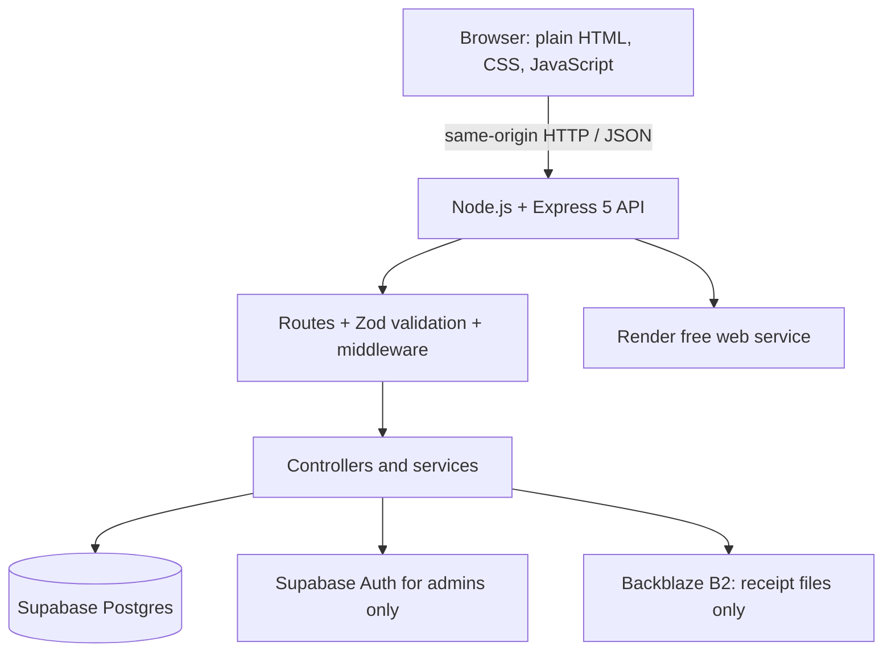

# Coffee Lab

Coffee Lab is a hackathon-scale custom-coffee ordering web app. Customers customize drinks, place pickup or delivery orders, and follow order progress. Payment is **cash only** at pickup or delivery.

## Architecture

Customer accounts use the app's custom `coffee_users` / `coffee_sessions` authentication; Supabase Auth is reserved for administrators. See `docs/adr/` for the decisions as they are documented.

## Requirements

- Node.js 20 or newer (use a currently supported Node LTS release).
- npm.
- A Supabase project and a private Backblaze B2 bucket for receipt files to run the complete app locally.
- No frontend build step; the browser loads plain HTML/CSS/JavaScript.

## Local setup

1. Clone the repository and enter the project directory.
2. Install locked dependencies: `npm ci`.
3. Copy `.env.example` to `.env` and set values locally. **Never commit `.env` or share its values.**
4. Configure the required Supabase and Backblaze values in your local environment.
5. Start the server: `npm start`.
6. Open `http://localhost:3000`.

The server validates required Supabase configuration on startup. The app's full flows also need the applicable database migrations and private B2 configuration. Review migrations and apply them manually in timestamp order; this project does not apply migrations automatically.

## Scripts

| Command | Purpose |
| --- | --- |
| `npm start` | Start Express with `node server.js`. |
| `npm test` | Run the test suite with Node's built-in test runner (`node --test`). |
| `npm ci` | Install exact dependency versions from `package-lock.json`. |

CI may also run ESLint, formatting checks, and an npm audit; see the workflow configuration once available.

## Environment variables

Names and purposes only; do not place actual values in documentation.

| Variable | Required | Purpose |
| --- | --- | --- |
| `PORT` | No | HTTP port; defaults to `3000`. Render supplies this automatically. |
| `NODE_ENV` | Deployment | Set to `production` in the deployed service for production security behavior. |
| `SUPABASE_URL` | Yes | Supabase project URL. |
| `SUPABASE_SERVICE_ROLE_KEY` | Yes | Server-only Supabase service-role key. Never expose it in browser code or logs. |
| `B2_BUCKET_NAME` | For receipts | Private Backblaze B2 bucket for generated receipts. |
| `B2_ENDPOINT` | For receipts | S3-compatible Backblaze endpoint. |
| `B2_REGION` | For receipts | Backblaze bucket region. |
| `B2_KEY_ID` | For receipts | Scoped Backblaze application key ID. |
| `B2_APPLICATION_KEY` | For receipts | Backblaze application key secret. |
| `TRUST_PROXY_HOPS` | Optional | Positive integer for the number of trusted reverse-proxy hops; leave unset unless deployment topology is known. |

## Cash-only checkout

Orders are paid in cash on pickup or delivery. Do not add online payment providers, transfers, e-wallets, gateways, or payment webhooks.

## Free-tier constraints

This is a one-week solo hackathon demo, not a production launch. The intended deployment is one Render free web service, Supabase free tier, and Backblaze B2 free storage. Free tiers have quotas, sleep/idle behavior, and provider-controlled limits that can change. Keep data and receipt sizes small, check current provider limits, and do not assume keep-alive requests can guarantee uptime. No paid service or staging environment is required.

## Repository workflow

- Work from a feature branch named `phase-<n>-<short-topic>`; do not push directly to `main`.
- Use conventional commit prefixes: `feat:`, `fix:`, `docs:`, `chore:`, `refactor:`, or `test:`.
- Open a pull request for review. Do not merge your own PR without the repository owner's decision.
- Run `npm test` before submitting code changes and report the real result.
- Never run database changes automatically. Review additive migrations and apply them manually.
- Read `AGENTS.md` and `.github/copilot-instructions.md` before using coding assistants.

## Project docs

- `DOCUMENTATION.md` — detailed source and security review.
- `CONTRIBUTING.md` — collaboration and pull-request workflow.
- `docs/adr/` — architecture decision records.
- `docs/runbook.md` — deploy, rollback, and operational notes.
- `PLAN.md` — hackathon roadmap and learning log.
- `AI-USAGE.md` and `docs/ai-logs/CHANGELOG-AI.md` — AI usage guidance and dated change evidence.

## License

MIT. See [LICENSE](LICENSE).
