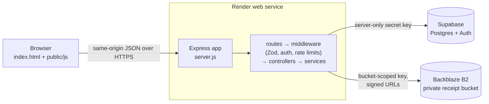

# Coffee Lab

Coffee Lab is a coffee customizer and ordering web app. Customers build a drink step by step (base, shots, milk, syrups, toppings), watch a live cup preview with estimated caffeine, calories, and sugar, and place pickup or delivery orders. Admins sign in with TOTP multi-factor authentication to manage orders and receipts.

- **Frontend:** plain HTML, CSS, and browser JavaScript (no build step), served by Express.
- **Backend:** Node.js + Express 5 (CommonJS), Zod validation, Helmet, rate limiting.
- **Data:** Supabase Postgres; Supabase Auth for admin MFA only.
- **Receipts:** PDF and image receipts in a private Backblaze B2 bucket, served through short-lived signed URLs.
- **Hosting:** Render web service, deployed from this GitHub repository.

For a deeper walkthrough (order lifecycle, security controls, design choices) see [DOCUMENTATION.md](DOCUMENTATION.md).

## Architecture



**Why it is shaped this way:** the browser never holds a database or storage credential. Every request goes through Express, which validates input, checks who the caller is, and calculates prices on the server, so a modified browser cannot change totals or reach other customers' data.

## Getting started

Prerequisites: Node.js 20 or newer (developed on Node 24), npm, a Supabase project, and optionally a Backblaze B2 bucket for receipts.

```bash
git clone https://github.com/SAKMAL08-maker/coffee-website.git
cd coffee-website
npm ci                    # install exact versions from package-lock.json
cp .env.example .env      # PowerShell: Copy-Item .env.example .env
```

1. Fill in `.env` (see the table below). Never commit it; `.gitignore` already excludes it.
2. Apply the SQL files in `supabase/migrations/` to your Supabase project **in filename (timestamp) order**, using the Supabase SQL editor.
3. Optional admin setup: follow the comments in `supabase/admin-account-setup.sql` and `scripts/admin-mfa-bootstrap.js`.
4. Start the server with `npm start` and open <http://localhost:3000>.

## Scripts

| Command | What it does |
|---|---|
| `npm start` | Runs `node server.js` (the same command Render uses). |
| `npm test` | Runs the Node.js built-in test runner over `test/`. The tests exercise validation, auth rejections, pricing, receipt generation, and the health check without network calls, and pass with no `.env`. They do not prove your live Supabase or B2 setup works. |
| `npm run lint` | ESLint (bug-finding rules) over all JavaScript. |
| `npm run format:check` / `npm run format` | Prettier check / rewrite. Not enforced in CI yet; the existing code predates the config. |

Every pull request runs `npm ci`, lint, tests, and `npm audit --omit=dev` in GitHub Actions ([`.github/workflows/ci.yml`](.github/workflows/ci.yml)).

## Health check

`GET /healthz` runs one tiny Supabase query and returns `200 {"status":"ok"}` or `503 {"status":"unavailable"}`. It is rate-limited (30 requests/minute) and reveals nothing else. Point a free uptime pinger at it to keep the free Render service awake and the Supabase project active (see below).

## Environment variables

Set these in `.env` locally and in the Render dashboard (**Environment** tab) in production. The values below are descriptions, not real values.

| Variable | Required | Description |
|---|---|---|
| `SUPABASE_URL` | Yes | Your Supabase project URL, e.g. `https://<project-ref>.supabase.co`. |
| `SUPABASE_SERVICE_ROLE_KEY` | Yes | Server-only Supabase key: a secret key (`sb_secret_…`) or the legacy `service_role` key. It bypasses row-level security, so it must never reach the browser. |
| `NODE_ENV` | Production | Set to `production` on Render to enable Secure cookies, HSTS, and HTTPS upgrades. |
| `PORT` | No | Port to listen on (default `3000`). Render sets this automatically. |
| `B2_BUCKET_NAME` | For receipts | Name of the private B2 bucket. |
| `B2_ENDPOINT` | For receipts | S3-compatible endpoint, e.g. `https://s3.<region>.backblazeb2.com`. |
| `B2_REGION` | For receipts | B2 region, e.g. `us-west-004`. |
| `B2_KEY_ID` | For receipts | Bucket-scoped application key ID. |
| `B2_APPLICATION_KEY` | For receipts | Bucket-scoped application key. |
| `TRUST_PROXY_HOPS` | No | Number of trusted reverse proxies (for correct client IPs in rate limiting). Leave empty unless you know your proxy setup. |

The `B2_*` variables are all-or-nothing: set all five or none. Without them, orders still work but receipts are marked unavailable.

## Free-tier notes

This project is designed to run on free plans. Know their limits:

- **Render (free web service):** the service spins down after about 15 minutes without traffic, and the next request takes roughly 30–60 seconds to wake it. The in-memory rate-limit counters reset whenever it restarts.
- **Supabase (free plan):** projects with no real database activity for about a week can be paused. A scheduled request to `/healthz`, which runs an actual query, keeps it active.
- **Keep-alive:** an external pinger (e.g. a free UptimeRobot or cron-job.org monitor) calling `https://<your-app>.onrender.com/healthz` every 10–14 minutes prevents both. One always-awake service uses about 744 of Render's 750 free instance hours per month, so do this for **one** service only.
- **Backblaze B2:** the first 10 GB of storage is free. Receipts are small, but consider a lifecycle rule if storage grows.

Plan limits change; check each provider's pricing page before relying on these numbers.

## Project structure

```text
config/        Supabase client setup
controllers/   HTTP request handlers (orders, users, coffees)
middleware/    Authentication, authorization, validation, origin checks, rate limits
public/        Browser JavaScript, CSS, privacy policy page
routes/        Express route definitions
schemas/       Zod request schemas
scripts/       Owner-run admin MFA bootstrap utility
services/      Business logic: drinks, receipts, B2 storage, account security, MFA
supabase/      Ordered SQL migrations and admin setup SQL
test/          Node test-runner tests
docs/ai-logs/  How AI-assisted work is recorded
```

## AI-assisted development

AI tools (GitHub Copilot, ChatGPT, Claude Code) have been used on this project, and every change is reviewed by the owner before merging. See [docs/ai-logs/](docs/ai-logs/README.md) for how that work is logged.

## License

[MIT](LICENSE)
